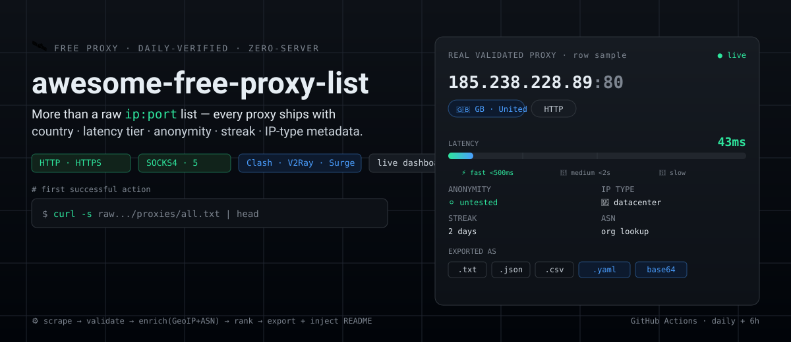
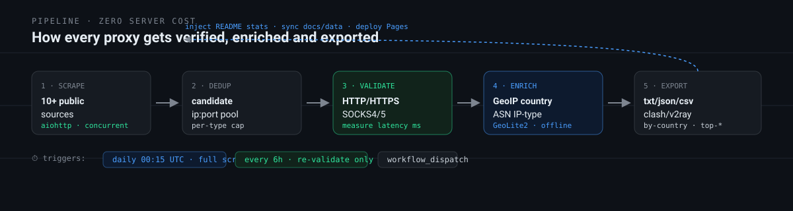

<div align="center">



[](https://github.com/kael-odin/awesome-free-proxy-list/actions/workflows/update.yml)
[](https://github.com/kael-odin/awesome-free-proxy-list/actions/workflows/refresh.yml)
[](LICENSE)
[](proxies/summary.json)
[](proxies/summary.json)
[](https://github.com/kael-odin/awesome-free-proxy-list/stargazers)

🌐 [在线仪表盘](https://kael-odin.github.io/awesome-free-proxy-list/) · 🔗 [Clash 订阅](https://kael-odin.github.io/awesome-free-proxy-list/data/clash/all.yaml) · 📦 [全部代理 all.txt](proxies/all.txt) · 📊 [统计 summary.json](proxies/summary.json)

</div>

---

> **为什么做这个。** 99% 的免费代理仓库只丢给你一份裸 `ip:port` 列表——没有国家归属、没有延迟、没有匿名度，无法判断是否泄露真实 IP，也没法一键导入。本仓库为每条代理附加完整元数据：**GeoIP 国家、延迟分档、匿名评级、连续存活天数、基于 ASN 的 IP 品类**，并预构建 Clash/V2Ray 订阅和可搜索的在线仪表盘。全部由 GitHub Actions **每日 + 每 6 小时**自动验证，零服务器成本。

```bash
# 一次成功的运行之后 —— 抓取可用列表（按延迟排序）
curl -s https://raw.githubusercontent.com/kael-odin/awesome-free-proxy-list/main/proxies/all.txt | head
```

## 📊 实时统计

<!-- STATS:START -->
数据更新（UTC）：**2026-10-29T13:14:11+00:00**

> 🏆 **信任锚点：4 个** — fast ∩ 高匿 ∩ 连续存活 ≥2 天，成功率最高的子集 [`proxies/top-trusted.txt`](proxies/top-trusted.txt) （新环境 streak 未积累之前可能为 0）。

| 类型 | 可用 | 候选总数 |
|---|---:|---:|
| HTTP | 307 | 330 |
| HTTPS | 27 | 330 |
| SOCKS4 | 63 | 82 |
| SOCKS5 | 26 | 97 |
| 全部 | 392 | 509 |
<!-- STATS:END -->

> 由 `scripts/update.py` 每次运行自动注入，无需手动维护。免费代理存活以分钟到小时计，数字每次运行自然波动。

## ✨ 你能得到什么

每条代理都带元数据，而不只是一个裸地址：

| 能力 | 本仓库 |
|---|:---:|
| 裸 `ip:port` 列表 | ✅ |
| 每日 + 每 6 小时自动验证 | ✅ |
| **GeoIP 国家归属** | ✅ |
| **延迟分档（fast / medium / slow）** | ✅ |
| **匿名评级（高匿 / 匿名 / 透明）** | ✅ |
| **连续存活天数 streak** | ✅ |
| **信任锚点子集（fast + 高匿 + streak≥2）** | ✅ |
| **IP 品类（经 ASN 推断 数据中心/住宅）** | ✅ |
| **Clash / V2Ray / Surge 订阅** | ✅ |
| **在线仪表盘（搜索 / 筛选 / 复制 / 下载）** | ✅ |
| **诚实的风险与匿名度披露** | ✅ |

> ## ⚠️ 风险与免责声明（务必阅读）
>
> **本仓库仅用于技术学习与公开数据聚合研究，不提供、也不运营任何代理服务。** 所有代理均来自第三方公开渠道，本项目对其安全性与合法性不做任何保证：
>
> - **安全** — 免费公共代理常来自被入侵的服务器、暴露的端口或无人维护的节点；运营者可以明文窥探你的流量、识别你访问的域名、注入页面、窃取 Cookie。每条代理都标注了**匿名度**（高匿 / 匿名 / 透明），但**透明代理会泄露你的真实 IP——绝不用于敏感操作**。即便是高匿代理，也无法阻止恶意运营者篡改流量。只用于爬虫测试或访问公开信息——**绝不用于登录、支付、账号操作或传输任何隐私数据。**
> - **稳定性** — 免费代理存活以分钟到小时计。`streak` / `stable.txt` 标记的是连续多日存活的代理，但不代表实时可用。
> - **合规** — 在许多司法辖区，未经授权使用跨境代理可能违法。你有责任遵守当地法律，本项目对任何后果概不负责。
> - **禁止滥用** — 不得利用这些代理逃避法律、攻击系统、滥用他人资源或侵犯他人权利。
>
> 使用即表示接受上述条款。敏感场景请选用合规的商业代理服务。

## ⚙️ 工作原理



- **来源** — `scripts/sources.txt`（每行一条 `<url> [http|https|socks4|socks5|mixed]`，10+ 公开源）
- **核心脚本** — `scripts/update.py`（抓取 → 验证 → 富化 → 多格式导出）
- **GeoIP** — `scripts/geoip_lookup.py`（`geoip2` + 社区镜像 GeoLite2-Country.mmdb，无需 license key，懒加载 + 7 天缓存 + 失败优雅降级）
- **单代理诊断** — `scripts/check.py IP:PORT`（连通性 / 延迟 / 出口 IP / 匿名度 / HTTPS CONNECT）
- **抽样实测** — `python scripts/test_proxies.py --type http --limit 5`

## 📥 下载与快速开始

所有产物都在 `proxies/` 目录：

| 文件 | 内容 |
|---|---|
| `proxies/all.txt` | 全部可用代理（按延迟排序、去重） |
| `proxies/http.txt` · `https.txt` | HTTP / HTTPS 正向代理 |
| `proxies/socks4.txt` · `socks5.txt` | SOCKS4 / SOCKS5 代理 |
| `proxies/top-http.txt` · `top-https.txt` · `top-socks5.txt` | 最快子集（默认 top 100） |
| `proxies/high-anon.txt` · `anonymous.txt` · `transparent.txt` | **按匿名度**（高匿最安全；透明会泄露真实 IP——慎用） |
| `proxies/stable.txt` · `fast-only.txt` · `top-trusted.txt` | 连续多日存活 / 仅 fast 档 / **信任锚点（fast + 高匿 + streak≥2）** |
| `proxies/all.csv` | CSV（国家/延迟/档位/匿名度/streak/ASN/IP 品类/来源）——Excel/pandas 直接可用 |
| `proxies/json/*.json` | 结构化 JSON：`ip/port/type/country/country_code/latency_ms/tier/anonymity/streak/asn/asn_org/ip_type/source` |
| `proxies/by-country/<CC>.txt` | 按国家分片（如 `US.txt`、`CN.txt`） |
| `proxies/clash/*.yaml` | **Clash/Mihomo 配置**（all/http/socks5/fast/high-anon/stable，含 proxy-groups + AUTO 自动测速 + 规则） |
| `proxies/v2ray/all.txt` | **V2Ray base64 订阅**（单行 base64，含全部节点） |
| `proxies/links/*.txt` | **链接列表**（`http://ip:port`、`socks5://ip:port`，含 high-anon/stable 子集） |
| `proxies/subscriptions.json` | 订阅清单（全部订阅的 Pages/raw 地址 + 导入指南 + 分类） |
| `proxies/history.json` · `history-summary.json` | 存活历史（每条代理的 streak + 分布） |
| `proxies/summary.json` | 汇总统计（`by_tier` / `by_country` / `by_anonymity` / `history` / `data_freshness` / `top_fastest` / `sources`） |

### Python `requests`

```python
import requests

proxy = "http://IP:PORT"  # all.txt 中的任意一行
proxies = {"http": proxy, "https": proxy}

resp = requests.get("https://httpbin.org/ip", proxies=proxies, timeout=10)
print(resp.text)
```

### Node.js（`axios` + `https-proxy-agent`）

```js
import axios from "axios";
import { HttpsProxyAgent } from "https-proxy-agent";

const agent = new HttpsProxyAgent("http://IP:PORT");
const { data } = await axios.get("https://httpbin.org/ip", { httpsAgent: agent, timeout: 10000 });
console.log(data);
```

### 在线仪表盘

不想下载文件？直接打开**[在线仪表盘](https://kael-odin.github.io/awesome-free-proxy-list/)**——搜索 IP / 国家 / 端口，按类型 · 国家 · 延迟档 · 匿名度 · IP 品类筛选，排序，一键复制或下载当前结果集。深色模式 + 中/EN 切换。

### 🔗 一键导入（Clash Verge / V2RayN / Surge）

预构建的订阅文件——粘贴链接即可，无需手动录入：

| 客户端 | 订阅链接 | 格式 |
|---|---|---|
| **Clash Verge / Mihomo** | `https://kael-odin.github.io/awesome-free-proxy-list/data/clash/all.yaml` | Clash YAML（HTTP+SOCKS5） |
| Clash Verge（仅 HTTP） | `https://kael-odin.github.io/awesome-free-proxy-list/data/clash/http.yaml` | Clash YAML |
| **V2RayN / V2Ray** | `https://kael-odin.github.io/awesome-free-proxy-list/data/v2ray/all.txt` | base64 订阅 |
| Surge / 通用链接 | `https://kael-odin.github.io/awesome-free-proxy-list/data/links/http.txt` | `http://ip:port` 列表 |

**导入步骤**：
1. **Clash Verge** — 打开 → 订阅（Profiles）→ 粘贴 Clash YAML 链接 → 更新 → 在代理页选中该配置 → 选 **🚀 PROXY** 或 **♻️ AUTO** 分组（AUTO 会自动测速选最快节点）。
2. **V2RayN** — 订阅 → 订阅设置 → 粘贴 v2ray base64 链接 → 更新（勾选 SOCKS5）。
3. **Surge** — 策略 → 新建外部代理列表 → 粘贴 links/http.txt 链接。

> 仪表盘的「🔗 一键导入」区块收录了全部链接 + 复制按钮 + 导入指南。免费代理质量参差——优先用 **♻️ AUTO** 自动测速分组。

## 🖥️ 本地运行

```bash
git clone https://github.com/kael-odin/awesome-free-proxy-list.git
cd awesome-free-proxy-list
python -m venv .venv
source .venv/Scripts/activate   # Windows Git Bash  # Linux/macOS: source .venv/bin/activate
pip install -r requirements.txt
python scripts/update.py         # 全量运行；小规模试跑见下方环境变量
```

环境变量（全部可选）：

| 变量 | 默认值 | 说明 |
|---|---|---|
| `PROXY_TIMEOUT_SEC` | `8` | 单代理测试超时（秒） |
| `PROXY_CONCURRENCY` | `200` | 最大并发验证数 |
| `PROXY_MAX_PER_TYPE` | `2000` | 每协议候选上限 |
| `PROXY_TOP_HTTP_LIMIT` | `100` | 最快 HTTP 子集大小 |
| `PROXY_GEOIP_ENABLE` | `1` | `0`/`false` 关闭 GeoIP |
| `PROXY_GEOIP_DB` | （缓存） | 本地 `.mmdb` 路径，跳过下载 |
| `PROXY_ANON_PROBE_TOP` | `0` | `0` = 匿名度探测覆盖全部已验证代理；`N` = 仅每类前 N 条（匿名度已在验证时内联探测；此项为兜底） |
| `PROXY_ANON_CONCURRENCY` | `40` | 匿名度兜底探测并发数 |
| `PROXY_STABLE_MIN_STREAK` | `2` | 进入 `stable.txt` 所需的最少连续存活天数 |

小规模试跑：

```bash
PROXY_MAX_PER_TYPE=50 PROXY_CONCURRENCY=50 python scripts/update.py
```

轻量刷新（只重新验证现有代理，不重新抓取——约快 5 倍）：

```bash
python scripts/update.py --refresh
```

### 本地预览仪表盘

```bash
cd docs && python -m http.server 8088   # 打开 http://localhost:8088
```

### 启用 GitHub Pages

仪表盘代码在 `docs/`，数据在 `docs/data/`（由 `update.py` 同步）。一次性设置：

1. **Settings → Pages → Build and deployment → Source** → **GitHub Actions**
2. 下一次 `update.yml` 运行即把 `docs/` 部署到 `https://<user>.github.io/awesome-free-proxy-list/`

> `deploy-pages` 任务已接好，无需额外操作。

## 🏷️ IP 品类：数据中心 vs 住宅

每个 IP 都标注 `ip_type` = `datacenter` / `residential` / `unknown`，依据 **GeoLite2-ASN** 组织名关键词匹配推断（不依赖付费 IP 信誉库）。

**诚实结论**：
- 免费公共代理池**几乎全是数据中心 IP**（云主机、VPS、配置失误或被入侵的开放端口）。真正的住宅 IP 在这里极少且短命——**免费列表无法稳定提供住宅 IP**。以近期数据为参考，住宅标签的占比是个位数到低两位数的百分比，且其余多为推断不出的小型/混合 ISP——这与免费代理生态的真实构成一致。
- `datacenter` — ASN 组织名匹配云/VPS/托管关键词（AWS、Google、Microsoft、DigitalOcean、OVH、Hetzner、Cloudflare、阿里、腾讯……）。
- `residential` — ASN 组织名匹配消费级/移动 ISP 关键词（Comcast、AT&T、中国电信、Vodafone……）——本池中占比很低。
- `unknown` — ASN 不可用，或组织名不在两张关键词表内（多为小型/混合 ISP）。这是**推断，不是真值**。

> 高信任场景（广告验证、反欺诈、长期稳定会话）需要真正的住宅 IP？**免费列表是错误来源**——请使用按流量计费、ASN 标注住宅池的商业住宅代理服务（如 Bright Data、Smartproxy、Oxylabs）。

## ❓ FAQ

- **🛡️ 免费代理安全吗？能用来登录 / 支付吗？**
  **不能。** 公共免费代理常来自被入侵的服务器或暴露端口；运营者可以明文窥探、识别域名、注入页面、窃取 Cookie。本仓库会检测匿名度并提供 `high-anon.txt`（高匿——不泄露真实 IP），但**即便是高匿代理也无法阻止恶意运营者篡改流量。** 只用于爬虫测试或访问公开信息——绝不用于登录、支付、账号操作或隐私数据。见顶部风险免责声明。

- **高匿 / 匿名 / 透明是什么意思？**
  - 🟢 **高匿 elite（high-anon）** — 不发送任何代理特征头；目标站无法察觉你在用代理。相对最安全。→ `high-anon.txt`。
  - 🟡 **匿名 anonymous** — 发送 `Via`/`X-Forwarded-For`；目标知道有代理，但看不到你的真实 IP。
  - 🔴 **透明 transparent** — 在 `X-Forwarded-For` 中泄露你的真实 IP——**不安全，仅作观察/学习用。**
  - ⚪ **未知 unknown** — 未探测成功（脚本在验证通过后内联探测匿名度，个别探测在限流下超时即标记未知）。可提高 `PROXY_ANON_PROBE_TOP` 扩大兜底探测范围。

- **为什么有些代理 `streak` 很高 / 出现在 `stable.txt`？**
  `streak` 是该代理**连续存活天数**（每通过一天验证 +1）。`stable.txt` 收录 `streak ≥ 2` 的代理——比随机列表稳定，但免费代理随时可能挂掉，不是可靠性保证。

- **为什么 `socks4.txt` / `socks5.txt` 有时是空的？**
  公共 SOCKS 代理极不稳定。脚本只发布**实际通过** HTTP/HTTPS 请求验证的代理，某些时间窗口 SOCKS 为 0 属正常现象。

- **严格验证下 `https.txt` 为什么非空？**
  `https.txt` 中的每条代理至少通过了 HTTP 测试。多数 HTTP 正向代理也能通过 CONNECT 处理 HTTPS；当没有代理显式通过 HTTPS 测试时，会把 HTTP 验证通过的列表作为 HTTPS 候选暴露——避免空文件，同时保住合理的质量门槛。

- **数据多久更新？会不会过期？**
  两个层级：**每日 00:15 UTC 全量**（重抓 10+ 来源 + 验证）+ **每 6 小时轻量刷新**（只重新验证现有代理，不重抓，约快 5 倍）。免费代理存活以分钟到小时计，实时可用性依然有限——仪表盘会显示更新时间，数据超过 30 小时会标 ⚠。需要实时可用性请用商业服务。

- **在系统代理 / VPN（Clash / TUN 模式）下能跑吗？**
  能，但流量会先经过你的系统代理/VPN，再经过免费代理。如果你的系统代理/VPN 出口 IP 被某些公共代理或 `httpbin.org` 拉黑，失败率会升高。想要干净的测试，可临时关闭系统代理。

- **GeoIP 国家数据准确吗？**
  使用 MaxMind GeoLite2-Country（社区镜像，每周更新）。免费 IP 库有滞后，作为代理地理参考足够。设 `PROXY_GEOIP_ENABLE=0` 可关闭。

- **如何贡献新来源？**
  编辑 `scripts/sources.txt`，加一行 `<raw_url> <type>`，提 PR。见 [CONTRIBUTING.md](CONTRIBUTING.md)。

## 🤝 参与贡献

欢迎 PR——新来源、验证逻辑改进、仪表盘增强。先读 [CONTRIBUTING.md](CONTRIBUTING.md)。⭐ Star 就是最好的支持！

## 📄 许可证

[MIT](LICENSE) © kael-odin

---

## 🇬🇧 English

A **free proxy list** that is **automatically verified daily + every 6h** via GitHub Actions (zero server cost).

**More than a raw list.** Not just `ip:port` text — every proxy comes with GeoIP country, latency tier, anonymity rating, survival streak, and ASN-based IP-type inference, plus prebuilt Clash/V2Ray subscriptions and a live dashboard.

| Capability | This repo |
|---|:---:|
| Raw `ip:port` list | ✅ |
| Daily + 6h auto-verify | ✅ |
| **GeoIP country** | ✅ |
| **Latency tier (fast/med/slow)** | ✅ |
| **Anonymity rating (elite/anon/transparent)** | ✅ |
| **Survival streak** | ✅ |
| **Top-trusted subset (fast + elite + streak≥2)** | ✅ |
| **IP-type (datacenter/residential via ASN)** | ✅ |
| **Clash/V2Ray/Surge subscription** | ✅ |
| **Live dashboard (search/filter/copy)** | ✅ |

**IP type tag:** each IP is classified `datacenter` / `residential` / `unknown` from its ASN org string (GeoLite2-ASN, no paid API). Honest finding: free public proxy pools are **overwhelmingly datacenter IPs** — real residential IPs are rare and short-lived here. For genuine residential IPs in high-trust use cases, use a paid residential proxy service.

### Quick start

```bash
# All working proxies (sorted by latency, deduped)
curl -s https://raw.githubusercontent.com/kael-odin/awesome-free-proxy-list/main/proxies/all.txt | head

# Structured JSON (country + latency + tier + source)
curl -s https://raw.githubusercontent.com/kael-odin/awesome-free-proxy-list/main/proxies/json/all.json | head
```

```python
import requests
proxy = "http://IP:PORT"  # one line from all.txt
proxies = {"http": proxy, "https": proxy}
print(requests.get("https://httpbin.org/ip", proxies=proxies, timeout=10).text)
```

### Outputs

Plain `txt` (one `host:port` per line), `json` (structured with country/latency/tier), `csv`, per-country split, and fastest subsets — see the artifact table in the Chinese section above. The [live dashboard](https://kael-odin.github.io/awesome-free-proxy-list/) lets you search, filter, copy and download without leaving the browser (Chinese/English toggle built in).

### Run locally

```bash
git clone https://github.com/kael-odin/awesome-free-proxy-list.git
cd awesome-free-proxy-list
python -m venv .venv && source .venv/bin/activate   # Windows: source .venv/Scripts/activate
pip install -r requirements.txt
python scripts/update.py
```

### Disclaimer

Free proxies are unstable and may be abused. **Do not use for sensitive traffic.** Use at your own risk. This repo only aggregates public sources; it does not operate any proxy server.

License: [MIT](LICENSE) © kael-odin
